# GPT-2 Model Pipeline
> Built from [`GPT2Model.ipynb`](file:///c:/Users/LENOVO/Downloads/BuildGPT2Model-main/BuildGPT2Model-main/GPT2Model.ipynb) · 124M parameters

```mermaid
flowchart TD
    A(["📝 Input Text\n'Every day is your'"])
    A --> B

    B["🔤 BPE Tokenizer\nGPT2Tokenizer.from_pretrained('gpt2')\n─────────────────────────────\nvocab_size = 50,257\nOutput: tensor of token IDs\nshape → (batch, seq_len)"]

    B --> C

    C["🧩 Token Embedding\nclass Embedding — nn.Embedding\n─────────────────────────────\n50,257 × 768 lookup table\nParams ≈ 38.6 M\nshape → (batch, seq_len, 768)"]

    C --> D

    D["📍 Positional Encoding\nclass PositionalEncoding — sinusoidal\n─────────────────────────────\npe even  = sin(pos / 10000^(2i/768))\npe odd   = cos(pos / 10000^(2i/768))\nAdded to token embeddings\nshape → (batch, seq_len, 768)"]

    D --> E

    E["💧 Dropout\nnn.Dropout(p=0.1)\n─────────────────────────────\nDrops 10% of values during training\nshape → (batch, seq_len, 768)"]

    E --> F

    subgraph TB ["🔁  Transformer Block  ×12"]
        direction TB
        F1["🔍 Layer Norm₁\nnn.LayerNorm(768)"]
        F1 --> F2
        F2["👁️ Multi-Head Attention\nclass MultiHeadAttention\n─────────────────────────\nn_heads = 12  |  head_dim = 64\nQ, K, V = Linear(768, 768)\nout    = Linear(768, 768)\nAttn = softmax(QKᵀ / √64) · V\nshape → (batch, seq_len, 768)"]
        F2 --> F3
        F3(["➕ Residual Add"])
        F3 --> F4
        F4["🔲 Layer Norm₂\nnn.LayerNorm(768)"]
        F4 --> F5
        F5["⚡ Feed-Forward Network\nclass FeedForward\n─────────────────────────\nfc1 : Linear(768 → 3072)\nGELU activation\nfc2 : Linear(3072 → 768)\nParams ≈ 4.7 M per block\nshape → (batch, seq_len, 768)"]
        F5 --> F6
        F6(["➕ Residual Add"])
    end

    F --> F1
    F6 --> G

    G["📊 Output Linear Layer\nnn.Linear(768 → 50,257)\n─────────────────────────────\nProjects to vocabulary logits\nParams ≈ 38.6 M\nshape → (batch, seq_len, 50,257)"]

    G --> H

    subgraph GEN ["🤖  generate_text_simple()"]
        direction TB
        H1["Crop context to last 1,024 tokens"]
        H1 --> H2
        H2["Forward pass  →  logits\nno_grad inference"]
        H2 --> H3
        H3["Slice last time-step logit\nshape → (batch, 50,257)"]
        H3 --> H4
        H4["softmax → probabilities\ntorch.softmax(logits, dim=-1)"]
        H4 --> H5
        H5["Greedy decode\ntorch.argmax(probas)"]
        H5 --> H6
        H6["Append token → repeat\ntorch.cat(idx, idx_next)"]
    end

    H --> H1
    H6 --> I

    I(["✅ Decoded Output Text\ntokenizer.decode(out)\n'Every day is yourriterlatest Basinarin harb'"])

    %% Styling
    classDef io       fill:#1e3a5f,stroke:#3b82f6,color:#bfdbfe,rx:20
    classDef proc     fill:#1e1b4b,stroke:#6366f1,color:#c7d2fe
    classDef attn     fill:#1a1a2e,stroke:#10b981,color:#6ee7b7
    classDef ffn      fill:#1c1a10,stroke:#f59e0b,color:#fde68a
    classDef norm     fill:#111827,stroke:#64748b,color:#94a3b8
    classDef residual fill:#0f2d1e,stroke:#22c55e,color:#86efac
    classDef gen      fill:#1c0a1e,stroke:#a855f7,color:#d8b4fe
    classDef out      fill:#052e16,stroke:#10b981,color:#6ee7b7,rx:20

    class A,I io
    class B,C,D,E,G proc
    class F2 attn
    class F5 ffn
    class F1,F4 norm
    class F3,F6 residual
    class H1,H2,H3,H4,H5,H6 gen
```

---

## Stage Summary

| # | Stage | Class | Output Shape | Key Params |
|---|-------|-------|--------------|------------|
| 0 | BPE Tokenizer | `GPT2Tokenizer` | `(B, T)` | vocab = 50,257 |
| 1 | Token Embedding | `Embedding` | `(B, T, 768)` | 38.6 M |
| 2 | Positional Encoding | `PositionalEncoding` | `(B, T, 768)` | sinusoidal, fixed |
| 2½ | Dropout | `nn.Dropout` | `(B, T, 768)` | p = 0.1 |
| 3a | Multi-Head Attention | `MultiHeadAttention` | `(B, T, 768)` | 12 heads, 64 head_dim |
| 3b | Feed-Forward | `FeedForward` | `(B, T, 768)` | 768→3072→768, GELU |
| 3c | Layer Norm ×2 | `nn.LayerNorm` | `(B, T, 768)` | per block |
| 3d | Residual Add ×2 | — | `(B, T, 768)` | skip connections |
| 4 | Output Linear | `nn.Linear` | `(B, T, 50257)` | 38.6 M |
| 5 | Text Generation | `generate_text_simple` | decoded string | greedy argmax |

> **B** = batch size · **T** = sequence length (max 1,024)
